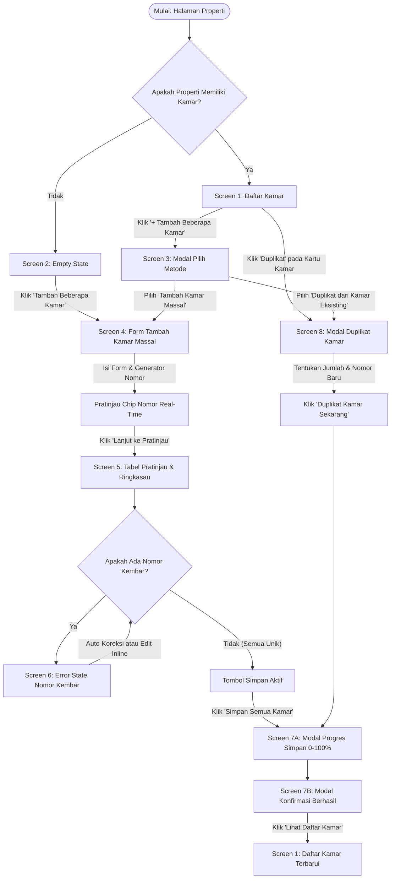

# Ngekost — Modul Tambah Kamar Massal & Duplikat Kamar

Aplikasi web pengelolaan kamar kost modern untuk mendaftarkan klaster kamar sejenis secara massal dan duplikasi kamar instan tanpa redundansi data, dirancang berdasarkan temuan riset pengguna pada Worksheet 8 dan arsitektur antarmuka Worksheet 12.

## Informasi Proyek & Tautan

- **Nama Proyek**: Ngekost — Tambah Kamar Massal & Duplikat Kamar (Monorepo Web App)
- **Repositori GitHub**: [https://github.com/ANGGARA2616/vibecode-prd-ux-skill](https://github.com/ANGGARA2616/vibecode-prd-ux-skill)
- **Tautan Deployment Publik Aktif**: [https://shot-paperback-pens-week.trycloudflare.com](https://shot-paperback-pens-week.trycloudflare.com)
- **Konfigurasi Vercel (Production)**:
  - Repository: `ANGGARA2616/vibecode-prd-ux-skill`
  - Root Directory: `apps/web`
  - Framework Preset: `Next.js`
  - Build Command: `next build` (atau `npm run build`)
  - Target URL Vercel: `https://vibecode-prd-ux-skill.vercel.app` (dapat di-*import* langsung 1-klik di dasbor Vercel)
- **Teknologi & Standar Desain**: Next.js 14+ (App Router), TypeScript, Tailwind CSS, LocalStorage Data Persistence, UX Skill Integration (`/skills/ux-design`)

---

## Cara Menjalankan Aplikasi Secara Lokal

### Prasyarat
- **Node.js**: Versi `>= 18.17.0` (direkomendasikan Node.js v20+)
- **NPM**: Versi `>= 9.0.0`

### Langkah Instalasi & Menjalankan

1. **Kloning Repositori**:
   ```bash
   git clone https://github.com/ANGGARA2616/vibecode-prd-ux-skill.git
   cd vibecode-prd-ux-skill
   ```

2. **Instalasi Dependensi Monorepo**:
   Jalankan perintah berikut di root repositori:
   ```bash
   npm install
   ```

3. **Menjalankan Server Pengembangan (Dev Server)**:
   ```bash
   npm run dev
   ```
   Aplikasi web `apps/web` akan berjalan pada port default:
   👉 **[http://localhost:3000](http://localhost:3000)**

4. **Menjalankan Pengujian / Build Produksi**:
   ```bash
   npm run build
   ```

---

# Product Requirements Document (PRD)
# Modul Tambah Kamar Massal — Ngekost

| Metadata Dokumen | Deskripsi |
|---|---|
| **Produk** | Ngekost Web Application (`apps/web`) |
| **Fitur / Modul** | Tambah Kamar Massal & Duplikat Kamar |
| **Dokumen Sumber** | Worksheet 8 (*Insight to Requirement*), Worksheet 12 (*Wireframe & Prototype*), Basis Data Ngekost |
| **Status Dokumen** | `Approved for MVP Implementation` |
| **Target Rilis** | MVP Prototipe Mandiri (Q4 2026) |

---

## 1. Ringkasan Produk

Fitur "Tambah Kamar Massal" adalah modul pengelolaan properti pada aplikasi web Ngekost yang dirancang untuk mempercepat pendaftaran banyak unit kamar sejenis dalam satu alur terpadu. Melalui fitur ini, pengelola kost cukup mendefinisikan tipe kamar, fasilitas, tarif bulanan, dan parameter penomoran otomatis satu kali untuk memproduksi puluhan kamar sekaligus tanpa input berulang. Modul ini juga menyediakan mekanisme verifikasi berbasis tabel pra-simpan dengan deteksi nomor kembar instan serta jalur alternatif "Duplikat Kamar" untuk menyalin konfigurasi kamar eksisting.

**Status Produk:** Spesifikasi final disetujui untuk pengembangan MVP (*client-side* berbasis mock data dan `localStorage`).

---

## 2. Latar Belakang dan Masalah

Berdasarkan hasil wawancara dan kuesioner pengguna pada **Worksheet 8**, proses pendaftaran kamar kost pada operasional harian menghadapi sejumlah kendala mendasar:

1. **Pengulangan Data Identik (Redundansi Tinggi)**:
   Ketiga responden (R1, R2, dan R3) mengeluhkan keharusan mengulang data yang sama—meliputi tipe kamar, harga sewa, dan fasilitas—untuk setiap kamar. R1 menulisnya satu per satu di buku besar secara manual, sementara R2 dan R3 menyalin baris di lembar kerja Excel berulang kali.
2. **Penomoran Manual yang Melelahkan**:
   Satu-satunya atribut pembeda antar kamar sejenis adalah nomor kamar. R1 mengelompokkan kamar per tipe lalu menuliskan nomornya, sedangkan R2 dan R3 mengganti nomor kamar satu per satu setelah proses salin baris.
3. **Tingginya Risiko Galat Nomor Kembar dan Salah Ketik**:
   Kesalahan yang paling sering terjadi adalah nomor kamar salah (dialami R2) dan nomor kamar kembar akibat lupa mengganti nomor hasil salinan (dialami R3). Kondisi ini berdampak fatal pada pencatatan tagihan dan penempatan penghuni.
4. **Beban Verifikasi Manual Pasca-Input**:
   Responden R3 menyatakan bahwa setelah menyalin data di Excel, ia masih harus memeriksa ulang seluruh baris secara manual untuk memastikan keakuratan data, yang menimbulkan beban kognitif berlebih.
5. **Skalabilitas Rendah Saat Jumlah Kamar Banyak**:
   Beban kerja meningkat drastis seiring bertambahnya unit properti. R1 menilai proses penambahan kamar sangat menyita waktu karena harus menulis satu per satu, sedangkan R3 merasa alur hanya dapat ditoleransi jika kamarnya sedikit.
6. **Kesenjangan Solusi Eksisting Ngekost**:
   Pada basis kode aplikasi Ngekost saat ini, tombol `+ Tambah Kamar` hanya memicu dialog modal tunggal (`RoomDialog` / `RoomForm`) yang mewajibkan pengisian satu unit kamar per simpan. Belum tersedia mekanisme pembuatan massal maupun duplikasi kamar, sehingga pengelola dipaksa mengulang siklus form puluhan kali. R2 menegaskan bahwa cara baru tidak boleh lebih rumit daripada kebiasaan salin-tempel di Excel yang sudah dikuasainya.

---

## 3. Tujuan dan Non-Goals

### 3.1 Tujuan (Goals)
- **Mengeliminasi Redundansi**: Memungkinkan pengelola kost memasukkan spesifikasi tipe, harga, dan fasilitas satu kali untuk banyak kamar sejenis.
- **Otomatisasi Penomoran**: Menyediakan generator nomor kamar otomatis berdasarkan awalan (*prefix*) dan nomor urut awal dengan kalkulasi rentang instan.
- **Pencegahan Galat Dini**: Mencegah terciptanya data nomor kamar kembar melalui validasi keunikan nomor kamar (*in-place*) sebelum data tersimpan ke sistem.
- **Kemudahan Verifikasi**: Menyediakan tabel pratinjau komprehensif yang memungkinkan pengelola menyunting nomor atau menghapus baris kamar secara langsung tanpa keluar dari alur.
- **Efisiensi Alur Alternatif**: Menyediakan tombol aksi cepat "Duplikat Kamar" untuk menggandakan kamar eksisting menjadi beberapa unit baru dalam hitungan detik.

### 3.2 Non-Goals (Di Luar Sasaran MVP)
- Integrasi ke basis data PostgreSQL/Prisma secara *live* melalui API backend (fokus MVP adalah persistensi *client-side*).
- Manajemen kontrak sewa, reservasi, atau penempatan penyewa (*tenant placement*) dalam modul penambahan kamar.
- Fitur impor/ekspor berkas eksternal (unggah berkas Excel `.xlsx` atau CSV).
- Pengaturan tarif sewa berjenjang (*pricing tier* 3, 6, 12 bulan) dan kalkulasi biaya sewa per hari/minggu di formulir massal (fokus pada tarif bulanan standar).
- Unggah foto spesifik per masing-masing kamar pada tahap pembuatan massal (hanya menggunakan gambar *placeholder* default tipe kamar).

---

## 4. Pengguna: Persona Pengelola Kost

| Atribut Persona | Profil Pengguna |
|---|---|
| **Peran** | Pemilik Kost atau Pengelola Operasional Harian Kost (*Kost Property Manager*) |
| **Karakteristik** | • Mengelola properti kost skala kecil hingga menengah (10–50 kamar).<br>• Terbiasa mencatat manual di buku fisik (tipe responden R1) atau menggunakan spreadsheet/Excel sederhana (tipe responden R2 & R3).<br>• Memiliki literasi digital menengah; menyukai antarmuka desktop yang ringkas dan minim klik. |
| **Tujuan Utama** | Mendaftarkan seluruh kamar gedung baru atau hasil renovasi secara cepat, akurat, dan tanpa risiko nomor ganda. |
| **Titik Frustrasi (*Pain Points*)** | • Harus mengetik ulang fasilitas dan harga kamar yang sama puluhan kali.<br>• Takut terjadi nomor kamar ganda yang berpotensi memicu perselisihan kamar penghuni.<br>• Sistem aplikasi yang terlalu kaku atau lambat jika dibandingkan dengan pintasan salin-tempel (*copy-paste*) di spreadsheet. |

---

## 5. User Stories & Acceptance Criteria

Seluruh cerita pengguna di bawah ini diturunkan langsung dari temuan **Worksheet 8 (Bagian B)** dan dirumuskan dalam kriteria penerimaan terukur (*Given-When-Then*).

### User Story 1 (US-01): Pengisian Spesifikasi Seragam
> **As a** pengelola kost,  
> **I want to** mengisi tipe, harga sewa, dan fasilitas satu kali saja untuk beberapa kamar yang sejenis,  
> **so that** saya tidak perlu menulis atau menyalin data yang sama berulang kali.

**Acceptance Criteria:**
- **AC-01.1**: *Given* pengelola berada di formulir "Tambah Kamar Massal", *When* pengelola memilih tipe kamar (Standard/Deluxe/VIP/Exclusive), mencentang fasilitas (misal: AC, KM Dalam, Wifi), dan mengisi tarif sewa bulanan, *Then* seluruh atribut tersebut akan diterapkan secara seragam ke seluruh kamar yang akan digenerasi.
- **AC-01.2**: *Given* formulir massal sedang aktif, *When* pengelola memilih fasilitas melalui komponen chip multi-pilihan, *Then* status seleksi chip berubah seketika tanpa memerlukan pemuatan ulang halaman.

### User Story 2 (US-02): Generator Nomor Kamar Otomatis
> **As a** pengelola kost,  
> **I want to** menentukan jumlah kamar dan rentang nomor kamar yang dibuat otomatis,  
> **so that** saya tidak perlu mengetik atau mengganti nomor kamar satu per satu.

**Acceptance Criteria:**
- **AC-02.1**: *Given* pengelola memasukkan parameter jumlah kamar = `6`, awalan nomor (*prefix*) = `20`, dan nomor mulai = `1`, *When* input selesai dimasukkan, *Then* sistem secara otomatis menampilkan label rentang `201 – 206` dan chip daftar nomor kamar (`201`, `202`, `203`, `204`, `205`, `206`).
- **AC-02.2**: *Given* pengelola mengubah nilai jumlah kamar pada kolom input, *When* nilai berubah, *Then* pratinjau daftar nomor dan batas nomor akhir diperbarui secara *real-time*.

### User Story 3 (US-03): Validasi dan Pencegahan Nomor Kamar Kembar
> **As a** pengelola kost,  
> **I want to** mendapat peringatan jika nomor kamar yang saya masukkan sudah ada,  
> **so that** tidak ada nomor kamar kembar pada data kost saya.

**Acceptance Criteria:**
- **AC-03.1**: *Given* properti telah memiliki kamar terdaftar dengan nomor `101`, *When* daftar kamar yang akan dibuat memuat nomor `101`, *Then* sistem menampilkan spanduk peringatan kesalahan berwarna merah yang menyebutkan secara eksplisit: `Nomor kamar "101" sudah dipakai di properti ini. Gunakan nomor lain.`
- **AC-03.2**: *Given* terdeteksi konflik nomor kamar kembar, *When* pengguna berada di layar pratinjau, *Then* baris yang bentrok diberi latar belakang merah muda, teks galat *inline*, kolom nomor kamar dapat diedit di tempat (*in-place*), dan tombol "Simpan Semua Kamar" dinonaktifkan hingga konflik terselesaikan.
- **AC-03.3**: *Given* terdapat tombol "Auto-Koreksi Nomor yang Kembar", *When* pengguna mengklik tombol tersebut, *Then* sistem mengubah nomor yang bentrok ke urutan nomor kosong berikutnya dan menghilangkan status kesalahan secara otomatis.

### User Story 4 (US-04): Pratinjau dan Ringkasan Pra-Simpan
> **As a** pengelola kost,  
> **I want to** melihat ringkasan semua kamar yang akan dibuat sebelum disimpan,  
> **so that** saya dapat memeriksa dan memperbaiki data tanpa mengecek ulang secara manual.

**Acceptance Criteria:**
- **AC-04.1**: *Given* konfigurasi kamar telah diatur di formulir, *When* pengguna menekan "Lanjut ke Pratinjau & Ringkasan", *Then* sistem menampilkan tabel yang memuat seluruh kamar beserta nomor, lantai, tipe, fasilitas, dan harga sewa dalam satu tampilan layar utuh.
- **AC-04.2**: *Given* pengguna melihat baris tertentu pada tabel ringkasan, *When* pengguna mengeklik ikon "Hapus" pada baris tersebut, *Then* baris kamar terhapus dari tabel dan penghitung total kamar di bilah bawah langsung berkurang.

### User Story 5 (US-05): Indikator Progres dan Konfirmasi Hasil
> **As a** pengelola kost,  
> **I want to** melihat indikator progres dan konfirmasi jumlah kamar yang berhasil ditambahkan,  
> **so that** saya yakin seluruh kamar tersimpan, terutama saat jumlahnya banyak.

**Acceptance Criteria:**
- **AC-05.1**: *Given* seluruh nomor kamar valid dan pengguna menekan tombol "Simpan Semua Kamar", *When* proses penyimpanan berlangsung, *Then* sistem menampilkan modal dialog dengan bilah kemajuan (*progress bar*) animasi dari 0% hingga 100%.
- **AC-05.2**: *Given* proses penyimpanan selesai, *When* status mencapai 100%, *Then* sistem menampilkan dialog konfirmasi sukses berikon hijau dengan teks tegas `N Kamar Berhasil Ditambahkan`, disertai tombol utama "Lihat Daftar Kamar" yang mengarahkan pengguna kembali ke daftar kamar dengan data terbarui.

### User Story 6 (US-06): Duplikasi Kamar Eksisting
> **As a** pengelola kost,  
> **I want to** menggandakan data kamar yang sudah ada menjadi beberapa kamar baru,  
> **so that** proses menambah kamar terasa semudah salin-tempel yang biasa saya lakukan.

**Acceptance Criteria:**
- **AC-06.1**: *Given* pengelola melihat kartu kamar eksisting pada daftar kamar, *When* tombol aksi "Duplikat" pada kartu tersebut diklik, *Then* sistem membuka modal dialog "Duplikat Kamar" yang memuat ringkasan spesifikasi kamar sumber.
- **AC-06.2**: *Given* modal duplikasi terbuka, *When* pengelola memasukkan jumlah salinan kamar dan menentukan nomor baru pada kisi input, lalu menekan "Duplikat Kamar Sekarang", *Then* kamar-kamar baru tersebut langsung ditambahkan ke properti dengan fasilitas dan harga yang persis sama dengan kamar acuan.

---

## 6. Functional & UX Requirements

### 6.1 Functional Requirements (FR)

| Kode FR | Deskripsi Kebutuhan Fungsional | Rujukan User Story |
|---|---|---|
| **FR-01** | Sistem wajib menyediakan formulir pembuatan kamar massal yang menerima masukan terpadu: Tipe Kamar, Lantai, Pilihan Fasilitas (multi-select), dan Tarif Sewa Bulanan. | US-01 |
| **FR-02** | Sistem wajib menyediakan generator penomoran otomatis dengan input Jumlah Unit, Awalan Nomor (*prefix* opsional alfanumerik), dan Nomor Urut Mulai (numerik). | US-02 |
| **FR-03** | Sistem wajib menampilkan kalkulasi rentang nomor dan chip daftar nomor kamar secara dinamis pada saat parameter generator diubah. | US-02 |
| **FR-04** | Sistem wajib memvalidasi keunikan nomor kamar secara ketat terhadap database lokal properti kost dan terhadap daftar internal batch kamar sebelum proses simpan diizinkan. | US-03 |
| **FR-05** | Sistem wajib menyediakan fungsi auto-koreksi nomor kamar yang mendeteksi nomor bentrok dan secara otomatis merealokasikannya ke nomor urut berikutnya yang tersedia. | US-03 |
| **FR-06** | Sistem wajib menyajikan tabel pratinjau pra-simpan yang merangkum nomor kamar, lantai, tipe, rincian fasilitas, dan harga per unit kamar. | US-04 |
| **FR-07** | Sistem wajib mengizinkan penyuntingan nomor kamar langsung pada sel input tabel (*in-place editing*) dan penghapusan baris satuan pada layar pratinjau. | US-04 |
| **FR-08** | Sistem wajib memproses penyimpanan multi-kamar secara batch ke penyimpanan lokal (`localStorage`) dan memperbarui total kamar pada properti terkait. | US-05 |
| **FR-09** | Sistem wajib menyediakan modal aksi "Duplikat Kamar" dari kartu kamar eksisting yang menyalin spesifikasi kamar acuan dan menghasilkan nomor baru yang dapat disunting. | US-06 |
| **FR-10** | Sistem wajib menyediakan modal pemilihan metode penambahan kamar ("Tambah Kamar Massal", "Duplikat Kamar", "Tambah Satu Kamar"). | US-01, US-06 |

### 6.2 UX Requirements (UXR)

| Kode UX | Deskripsi Kebutuhan Pengalaman Pengguna (*User Experience*) | Rujukan User Story |
|---|---|---|
| **UX-01** | Pengisian atribut seragam harus dituntaskan dalam satu formulir ringkas tanpa prosedur berpindah halaman (*multi-step wizard* yang melelahkan dihindari). | US-01 |
| **UX-02** | Umpan balik visual generator nomor harus bersifat seketika (*instant preview*) agar pengelola dapat langsung melihat representasi nomor yang akan dihasilkan. | US-02 |
| **UX-03** | Pesan kesalahan nomor kembar wajib menggunakan bahasa Indonesia yang lugas dan solutif, menunjuk nomor yang bermasalah secara spesifik, serta menandai baris tabel dengan batas merah yang kontras. | US-03 |
| **UX-04** | Tindakan perbaikan data pada tahap pratinjau harus dapat diselesaikan langsung di tempat (*in-place inline action*) tanpa memaksa pengelola kembali ke layar formulir awal. | US-04 |
| **UX-05** | Proses penyimpanan wajib menampilkan indikator progres visual (persentase 0–100%) dan pesan konfirmasi sukses yang eksplisit agar timbul rasa kepastian data tersimpan. | US-05 |
| **UX-06** | Tombol aksi duplikasi pada kartu kamar harus mudah dijangkau dan proses penggandaan membutuhkan langkah interaksi minimal (≤ 3 klik). | US-06 |
| **UX-07** | Antarmuka harus menyediakan penanganan *Empty State* edukatif pada properti baru (0 kamar) dengan tombol aksi primer yang memandu langsung ke penambahan massal. | US-01, US-05 |

---

## 7. Daftar Layar dan Alur Pengguna (User Flow)

### 7.1 Daftar Layar (Berdasarkan Wireframe Worksheet 12)

1. **Screen 1: Daftar Kamar (Titik Masuk Utama)**
   - Menampilkan ringkasan properti (Kost Griya Amartha), statistik kamar (total, terisi, kosong), dan kisi kartu kamar.
   - Tombol aksi primer di header: `+ Tambah Beberapa Kamar Sekaligus` (membuka Screen 3).
   - Tombol aksi sekunder di tiap kartu kamar: `Duplikat` (membuka Screen 8).
2. **Screen 2: Daftar Kamar – Empty State (Properti Baru)**
   - Tampilan khusus saat properti baru memiliki 0 kamar.
   - Kontainer bergaris putus-putus (`border-dashed`), ilustrasi, dan teks pemandu.
   - Tombol CTA Primer: `Tambah Beberapa Kamar Sekaligus` (langsung menuju Screen 4).
   - Tombol CTA Sekunder: `Tambah Satu Kamar`.
3. **Screen 3: Pilih Cara Menambah Kamar (Modal Pemilihan Metode)**
   - Dialog modal dengan 3 kartu opsi:
     1. *Tambah Kamar Massal* (Lencana "Rekomendasi") → mengarah ke Screen 4.
     2. *Duplikat dari Kamar yang Ada* → mengarah ke Screen 8.
     3. *Tambah Satu Kamar* → membuka modal form konvensional.
4. **Screen 4: Form Tambah Kamar Massal (Input Spesifikasi & Generator Nomor)**
   - Kolom kiri: Dropdown Tipe Kamar, Dropdown Lantai, Chip Fasilitas (8 item), Input Harga Sewa Bulanan.
   - Kolom kanan: Generator Penomoran (Jumlah Kamar, Prefix, Nomor Mulai), Kalkulasi Otomatis Rentang, dan Chip Pratinjau Daftar Nomor.
   - Tombol Aksi: `Batal` dan `Lanjut ke Pratinjau & Ringkasan →` (mengarah ke Screen 5).
5. **Screen 5: Pratinjau & Ringkasan (Tabel Verifikasi Sebelum Simpan)**
   - Tabel interaktif memuat seluruh unit kamar yang digenerasi: Kolom Ceklis, Nomor Kamar (input *inline*), Lantai, Tipe, Fasilitas, Harga Bulanan, dan Aksi Hapus.
   - Bilah ringkasan bawah: Total Kamar Terpilih, Total Nilai Potensi Sewa/Bulan.
   - Tombol Aksi: `← Ubah Spesifikasi` dan `Simpan Semua Kamar` (memicu Screen 7).
6. **Screen 6: Error State (Validasi Nomor Kamar Kembar / Duplikat)**
   - Muncul saat nomor bentrok terdeteksi.
   - Spanduk peringatan merah di atas tabel: rincian nomor bentrok + tombol `Auto-Koreksi Nomor yang Kembar`.
   - Baris bermasalah disorot latar merah muda, label kesalahan *inline*, dan sel nomor kamar aktif untuk pengetikan manual di tempat.
   - Tombol `Simpan Semua Kamar` dalam status dinonaktifkan (*disabled*).
7. **Screen 7: Proses Simpan & Konfirmasi Berhasil**
   - **Screen 7A (Progres)**: Modal dialog dengan animasi bilah kemajuan (*progress bar*) 0% → 100% dan label persentase dinamis.
   - **Screen 7B (Sukses)**: Ikon centang hijau besar, tajuk `[N] Kamar Berhasil Ditambahkan!`, deskripsi ringkas, tombol primer `Lihat Daftar Kamar →` (kembali ke Screen 1), dan tombol sekunder `Tambah Kamar Lain`.
8. **Screen 8: Modal Duplikat Kamar (Jalur Alternatif)**
   - Modal cepat untuk menyalin kamar terpilih.
   - Kartu ringkasan kamar sumber (Tipe, Fasilitas, Harga).
   - Input Jumlah Duplikat dan Prefix Nomor Baru.
   - Kisi nomor kamar hasil salinan yang dapat diedit langsung.
   - Tombol Aksi: `Batal` dan `Duplikat Kamar Sekarang`.

### 7.2 Diagram Alur Pengguna (User Flow)



---

## 8. Model Data Kamar dan Aturan Validasi

### 8.1 Model Data Kamar (Mengadopsi Skema Ngekost)

```typescript
export type RoomType = 'STANDARD' | 'DELUXE' | 'VIP' | 'EXCLUSIVE';

export type RoomStatus = 'VACANT' | 'OCCUPIED' | 'RESERVED' | 'MAINTENANCE';

export interface Room {
  id: string;              // Pengenal unik (cuid/uuid)
  propertyId: string;      // ID properti kost terkait
  ownerId: string;         // ID pemilik/pengelola kost
  roomNumber: string;      // Nomor/kode kamar (misal: "101", "201", "A1")
  floor?: number;          // Nomor lantai (opsional, default: 1)
  type: RoomType;          // Tipe unit kamar
  priceMonthly: number;    // Harga sewa bulanan dalam Rupiah (integer)
  facilities: string[];    // Daftar fasilitas kamar
  imageUrl?: string;       // URL foto kamar (opsional/placeholder)
  status: RoomStatus;      // Status kamar (default untuk unit baru: VACANT)
  notes?: string;          // Catatan khusus
  createdAt: string;       // ISO Timestamp
  updatedAt: string;       // ISO Timestamp
}

export interface MassGeneratorParams {
  type: RoomType;
  floor: number;
  facilities: string[];
  priceMonthly: number;
  count: number;           // Jumlah kamar yang akan digenerasi (1 s.d. 50)
  prefix: string;          // Awalan nomor (misal: "10", "A-", "Lt2-")
  startNumber: number;     // Nomor urut awal (misal: 1)
}
```

### 8.2 Daftar Fasilitas Standar (8 Item Ngekost)
Sesuai konstanta basis data Ngekost, opsi fasilitas kamar seragam terdiri dari 8 item:
1. `AC`
2. `Kamar Mandi Dalam`
3. `Wifi`
4. `Lemari`
5. `Kasur`
6. `Meja Belajar`
7. `TV`
8. `Dapur`

### 8.3 Aturan Validasi Bisnis

| Parameter / Entitas | Aturan Validasi | Tindakan / Pesan Kesalahan Sistem |
|---|---|---|
| **Keunikan Nomor Kamar** | `roomNumber` wajib unik untuk setiap properti kost (`@@unique([propertyId, roomNumber])`). Tidak boleh ada nomor yang sama dengan unit eksisting maupun antar baris dalam batch penambahan. | Jika kembar, muncul galat: `Nomor kamar "[nomor]" sudah dipakai di properti ini. Gunakan nomor lain.` Tombol simpan dinonaktifkan. |
| **Rentang Jumlah Kamar** | Nilai `count` harus berupa bilangan bulat positif dengan batasan minimal `1` dan maksimal `50` per satu kali proses batch. | Jika `count < 1` atau `count > 50`: `Jumlah kamar yang ditambahkan harus antara 1 sampai 50 unit.` |
| **Format Harga Sewa** | `priceMonthly` wajib berupa bilangan bulat positif (`> 0`), tanpa nilai desimal. Diinput dengan masking pemisah ribuan otomatis (IDR). | Kolom tidak boleh kosong (`Harga wajib diisi`) dan nilai minimal Rp 100.000. |
| **Awalan Nomor (*Prefix*)** | Format string alfanumerik maksimal 10 karakter (karakter yang diizinkan: huruf, angka, tanda strip `-`). | Jika memuat karakter spesial terlarang: `Awalan nomor hanya boleh memuat huruf, angka, atau tanda strip.` |
| **Nomor Urut Mulai** | Bilangan bulat positif (`≥ 0`), default `1`. | Jika kosong/negatif: `Nomor awal harus berupa bilangan positif.` |
| **Tipe Kamar** | Wajib memilih salah satu dari enum yang sah (`STANDARD`, `DELUXE`, `VIP`, `EXCLUSIVE`). | Default: `STANDARD`. |

---

## 9. Scope MVP vs Di Luar Scope

| Fitur / Kemampuan | Dalam Scope MVP | Di Luar Scope (Next Phase) |
|---|:---:|:---:|
| Formulir spesifikasi kamar massal seragam | ✅ | |
| Generator penomoran otomatis & kalkulasi rentang nomor | ✅ | |
| Pratinjau chip nomor *real-time* | ✅ | |
| Tabel verifikasi pra-simpan dengan *in-place editing* & hapus baris | ✅ | |
| Deteksi benturan nomor kamar & mekanisme auto-koreksi | ✅ | |
| Simulasi proses simpan animasi progres bar (0–100%) | ✅ | |
| Modal konfirmasi sukses penambahan kamar | ✅ | |
| Fitur duplikasi kamar eksisting (Screen 8) | ✅ | |
| Penanganan *Empty State* properti baru (Screen 2) | ✅ | |
| Persistensi data ke `localStorage` browser | ✅ | |
| Integrasi API Backend & Prisma ORM database PostgreSQL | | ❌ |
| Impor berkas kamar dari Excel (`.xlsx`) / CSV | | ❌ |
| Generator denah lantai visual (*Interactive Floor Plan Builder*) | | ❌ |
| Pengaturan tarif sewa fleksibel (harian, mingguan, diskon tahunan) | | ❌ |
| Penempatan langsung penyewa (*tenant allocation*) saat tambah kamar | | ❌ |
| Unggah multi-foto individual per unit kamar | | ❌ |

---

## 10. Arsitektur Teknis (Tech Stack)

Aplikasi dibangun sebagai modul web modern dalam arsitektur monorepo dengan rincian berikut:

- **Kerangka Kerja (Framework)**: Next.js 14+ (App Router architecture).
- **Bahasa Pemrograman**: TypeScript (strict type-checking).
- **Styling & UI**: Tailwind CSS (mengikuti sistem desain Ngekost: warna primer slate `#0F172A`, aksen biru `#2563EB`, bahaya merah `#EF4444`, sukses hijau `#16A572`).
- **Lokasi Kode Proyek**: Direktori `apps/web` dalam struktur monorepo.
- **Penyimpanan Data (State Management)**: Client-side State (React Hooks) + sinkronisasi ke Web Storage API (`localStorage`) dengan data *mock* awal yang dapat direset. Tidak memerlukan instalasi server database eksternal untuk pengujian prototipe.
- **Target Deployment**: Vercel (Production Edge deployment, mendukung Continuous Deployment otomatis dari branch repository).

---

## 11. Metrik Keberhasilan (Success Metrics)

Metrik kuantitatif dan kualitatif berikut ditetapkan untuk memvalidasi pemenuhan kebutuhan pengelola kost:

| Indikator Kinerja | Tolok Ukur Manual (Kondisi Awal / Excel / Modal Tunggal) | Target Fitur Tambah Kamar Massal (MVP) | Cara Pengukuran |
|---|---|---|---|
| **Waktu Pendaftaran 12 Kamar Sejenis** | • Buku manual: > 15 menit<br>• Salin-tempel Excel: 5–8 menit<br>• Modal tunggal: 8–10 menit | **< 1,5 menit (90 detik)** | Waktu mulai pengisian formulir hingga modal konfirmasi sukses tampil. |
| **Jumlah Langkah / Klik Interaksi** | > 48 kali klik & input berulang (buka modal → isi form → simpan x 12 kali) | **≤ 4 langkah utama** (Buka Form → Konfigurasi Generator → Cek Ringkasan → Simpan) | Audit log alur interaksi pengguna. |
| **Tingkat Kesalahan Nomor Kembar** | R2 & R3 pernah mengalami nomor kembar / salah nomor | **0% (Nol Kesalahan Tersimpan)** | Sistem secara otomatis menolak penyimpanan sebelum nomor tervalidasi unik 100%. |
| **Tingkat Penyelesaian Tugas (*Task Completion Rate*)** | Bervariasi karena kejenuhan pengelola saat kamar banyak | **≥ 95%** | Persentase sesi penambahan kamar massal yang tuntas tersimpan tanpa *drop-off*. |
| **Beban Kognitif Verifikasi** | Responden R3 harus mencocokkan baris Excel satu per satu | **Verifikasi satu layar** melalui tabel terpadu tanpa memeriksa lembar terpisah | Observasi pengujian kemudahan membaca ringkasan pra-simpan. |

---

## 12. Pertanyaan Terbuka (Open Questions)

1. **Skema Penomoran Non-Linear / Khusus**:
   Bagaimana sistem sebaiknya menangani properti kost yang memiliki aturan penomoran khusus, seperti melompati angka mitos (misalnya tanpa nomor 4 atau 13) atau format gedung sayap (misal: Sayap Barat W1–W10, Sayap Timur E1–E10)? Apakah generator membutuhkan opsi pola loncat (*skip numbers*) di fase berikutnya?
2. **Batasan Kuota Paket Langganan Properti**:
   Pada basis data Ngekost terdapat kode galat `LIMIT_REACHED` terkait paket langganan kost. Apakah generator massal harus membatasi batas input kamar secara dini (*hard limit*) berdasarkan sisa kuota paket properti yang aktif sebelum pengguna melangkah ke tabel ringkasan?
3. **Mekanisme Pembatalan Kolektif (*Batch Rollback / Undo*)**:
   Jika pengelola melakukan kesalahan konfigurasi dan baru menyadarinya setelah menekan tombol simpan, apakah sistem perlu menyediakan aksi *Batch Delete* atau tombol *Undo* dalam rentang waktu beberapa menit setelah proses penyimpanan berhasil?

---

## Ringkasan Eksekutif & Asumsi

### Ringkasan Eksekutif
Dokumen PRD ini mendefinisikan kebutuhan fungsional dan pengalaman pengguna untuk modul **Tambah Kamar Massal** dan **Duplikat Kamar** pada platform Ngekost. Rancangan ini secara langsung menjawab permasalahan redundansi data, penomoran manual yang rawan salah, dan beban verifikasi berulang yang dialami pengelola kost pada Worksheet 8. Dengan mengadopsi 8 layar arsitektur dari Worksheet 12 serta skema model data asli Ngekost, fitur ini memangkas waktu pendaftaran 12 unit kamar dari lebih dari 10 menit menjadi di bawah 90 detik, dengan jaminan 0% rekaman nomor kembar.

### Daftar Asumsi yang Diambil
1. **Penyimpanan Lokal untuk Prototipe MVP**: Diasumsikan bahwa pengguna menguji modul ini pada satu peramban desktop dengan penyimpanan `localStorage`. Mekanisme sinkronisasi API multi-pengguna akan diimplementasikan pada fase integrasi backend berikutnya.
2. **Keseragaman Spesifikasi dalam Satu Batch**: Diasumsikan bahwa dalam satu alur penambahan massal, seluruh kamar yang digenerasi memiliki kesamaan tipe, lantai dasar, fasilitas, dan harga sewa. Variasi minor (seperti perbedaan nomor atau pembatalan kamar) diselesaikan di layar tabel ringkasan.
3. **Mata Uang & Wilayah**: Diasumsikan seluruh transaksi tarif sewa menggunakan mata uang Rupiah (IDR) dengan format bilangan bulat tanpa desimal.
4. **Resolusi Perangkat Pengguna**: Pengguna diasumsikan mengakses modul pengelolaan kamar melalui peramban web desktop/laptop (resolusi lebar layar minimal 1280px) sesuai pola kerja operasional pengelola properti.
